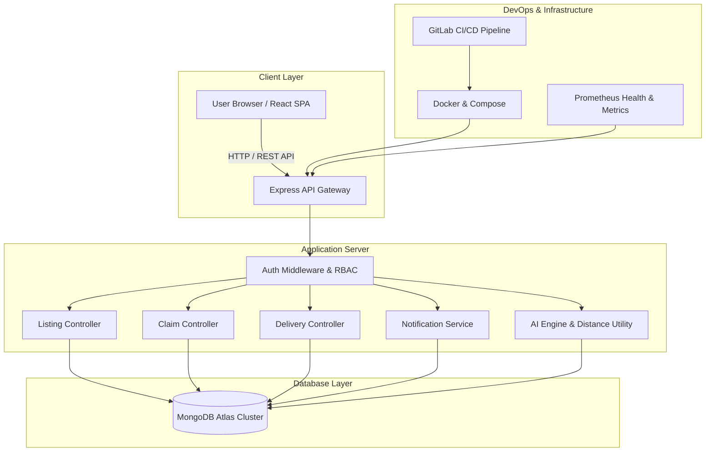

# Architecture Specification — Don't Waste It

## Overview
**Don't Waste It** is a full-stack, location-aware food rescue and zero-waste redistribution platform. It connects surplus food donors (restaurants, hotels, events) with verified food seekers (NGOs, shelters, community centers) and logistics volunteers.

---

## High-Level System Architecture Diagram

---

## Technical Stack

| Layer | Technology | Description |
|---|---|---|
| **Frontend** | React 18 + Vite | Premium UI/UX, SPA routing, Tailwind/Vanilla CSS, Lucide Icons, Leaflet Maps |
| **Backend** | Node.js + Express | REST API, JWT Authentication, Express-Validator, Haversine Math |
| **Database** | MongoDB + Mongoose | Document Database, Indexes, Populate Relations, Aggregation Pipelines |
| **Location & Maps** | OpenStreetMap + Leaflet | Free tile layer map rendering, coordinate distance filtering |
| **AI Engine** | Deterministic NLP + Heuristics | Zero-cost text parsing, smart recommendation scoring, demand insights |
| **Containerization** | Docker + Docker Compose | Multi-stage Dockerfiles, Nginx static serving, local Compose stack |
| **CI/CD** | GitLab CI/CD | 4-stage pipeline (Install, Test, Build, Docker Build) |
| **Monitoring** | Prometheus Endpoint | `/api/metrics` + `/api/health` with memory, request, error, and uptime stats |

---

## Security Architecture

1. **Password Safety**: Salted password hashing using `bcryptjs` (10 rounds).
2. **JWT Auth**: Stateless JSON Web Tokens signed with secret, set to expire in 7 days.
3. **Role-Based Access Control (RBAC)**: Strict role guards (`FOOD_PROVIDER`, `FOOD_SEEKER`, `VOLUNTEER`, `ADMIN`).
4. **Data Privacy**: Public endpoints expose only approximate location/city and distance badges (e.g. `"1.4 km away"`). Exact addresses are restricted to active claim participants.
5. **No Secrets Hardcoding**: All secrets, DB strings, and API keys managed exclusively via `.env` environment variables.
